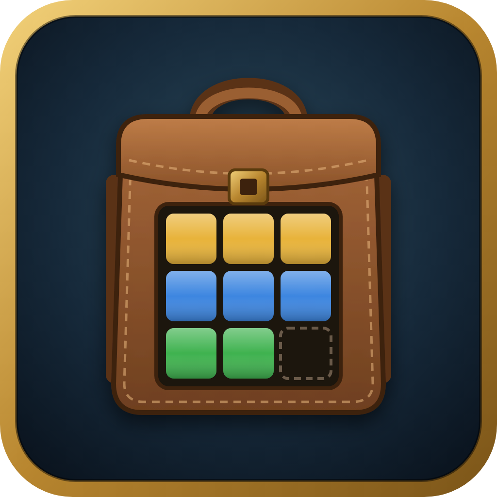

  

# Tidy Pack

Tidy Pack sorts the game's own bag window into clear groups, so you find what you need at a
glance. It is an addon for **WoW Forever** (Interface 16001), with mouse or controller.

It doesn't replace your bags with a new window. It keeps the game's own backpack and money
display, and simply puts your items in order. Everything the game lets you do with
an item – use, equip, sell, split, link – works as usual, also with a controller.

## Install

- **CurseForge:** search for "Tidy Pack" in the CurseForge app or on curseforge.com.
- **By hand:** download `TidyPack-<version>.zip` from [Releases](https://github.com/danieldichterheineman/TidyPack/releases)
  and unpack it into `World of Warcraft/_forever_/Interface/AddOns/`, so that the folder is
  called `TidyPack`. Releases marked **Pre-release** are test versions.

## What it does

- **Groups:** Favorites, New, Consumables, Equipment, crafting materials by type, Quest Items,
  Keys, Spare Bags, Miscellaneous and Junk, in five parts. Drop an item anywhere in the bag to
  put it away. Special bags (quivers, soul bags, profession bags, the reagent bag) get their own
  part at the bottom. Optional: show by bag, and a search box.
- **Your own groups:** make groups like "Potions", and put single items or whole item types
  in them by Alt-clicking an item.
- **Quests:** quest items show "3/7", and the Quests tab lists your quests – open one to see its
  items and what is still missing.
- **Bank:** a Bank tab sorts your bank the same way, shows its bag slots, and remembers it when
  you're away.
- **All your characters:** item tooltips show how many you have in your bags and bank, and what
  your other characters on the same realm have. Point at your money for everyone's money and the
  total.
- **Locks:** quest items, items your quests ask for and items in the game's equipment sets can't
  be sold by mistake at a merchant (can be turned off in the gear button's menu).
- **Junk list and full bags:** Tidy Pack asks before deleting anything, and only when you
  press Delete.
- **Your bags at a glance:** the Tidy Pack logo replaces the game's bag buttons, and your bags
  are shown at the bottom of the bag window – drop a bigger bag on one to swap it.
- **Favorites, upgrade arrows, item level and BoE, Questie hints and full controller support.**
- **In the game's eleven languages**, following the game or picked in the gear button's menu
  (machine-translated – corrections welcome).

The complete list, usage and known limitations are in [README.md](../README.md), which is also
the CurseForge description.

## Feedback

Found a bug or have an idea? [Open an issue](https://github.com/danieldichterheineman/TidyPack/issues).
If a message from Tidy Pack shows up in your chat, please include it.

## Development

Developer notes are in [AGENTS.md](../AGENTS.md), and changes are in
[CHANGELOG.md](../CHANGELOG.md). Design sketches and the logo are in `.design/`.

## License

[MIT](../LICENSE). The logo is original artwork.
