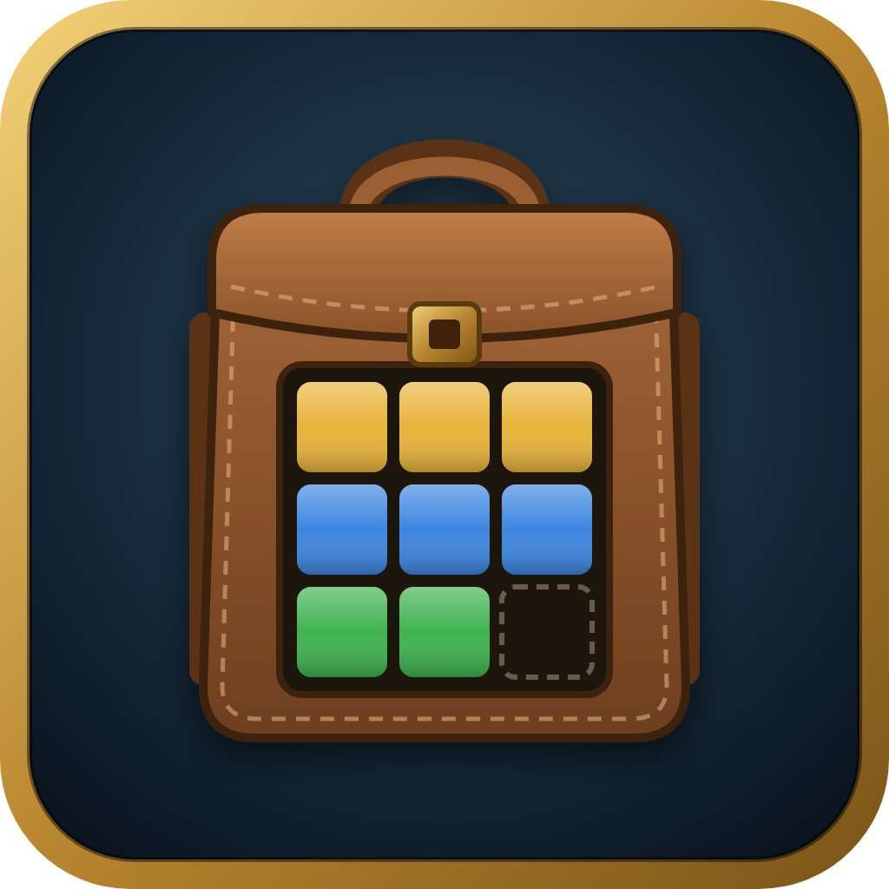

  

# Tidy Pack

Tidy Pack sorts the game's own bag window into clear groups, so you find what you need at a
glance. It is an addon for **WoW Forever** (Interface 16001), with mouse or controller.

It doesn't replace your bags with a new window. It keeps the game's own backpack, search box
and money display, and simply puts your items in order. Everything the game lets you do with
an item – use, equip, sell, split, link – works as usual, also with a controller.

## Install

- **CurseForge:** Tidy Pack is waiting for approval there. A link will be added here when it
  is live.
- **By hand:** download `TidyPack-<version>.zip` from [Releases](https://github.com/danieldichterheineman/TidyPack/releases)
  and unpack it into `World of Warcraft/_forever_/Interface/AddOns/`, so that the folder is
  called `TidyPack`. Releases marked **Pre-release** are test versions.

## What it does

- **Groups:** Favorites, New, Consumables, Equipment, Trade Goods, Quest Items, Keys, Spare
  Bags, Miscellaneous and Junk. An "Add to bag" slot shows your free slots and takes dropped
  items. Special bags (quivers, soul bags, profession bags, the reagent bag) get their own
  groups at the bottom.
- **Sets:** collect items under a name and icon, like "Fishing", in the Sets tab. Click a set
  to put it on, or use its gear button and choose "Add What I'm Wearing". Missing items are
  greyed out.
- **Locks:** quest items, items your quests ask for and items in your sets can't be sold by
  mistake at a merchant (can be turned off in the settings).
- **Junk list and full bags:** Tidy Pack asks before deleting anything, and only when you
  press Delete.
- **Favorites, item level and BoE, quick bag swaps, Questie hints, key bindings and full
  controller support.**

The complete list, usage and known limitations are in [README.md](../README.md), which is also
the CurseForge description.

## Feedback

Found a bug or have an idea? [Open an issue](https://github.com/danieldichterheineman/TidyPack/issues).
If a message from Tidy Pack shows up in your chat, please include it.

## Development

Developer notes (in Swedish) are in [AGENTS.md](../AGENTS.md), and changes are in
[CHANGELOG.md](../CHANGELOG.md). Design sketches and the logo are in `.design/`.

## License

[MIT](../LICENSE). The logo is original artwork.
